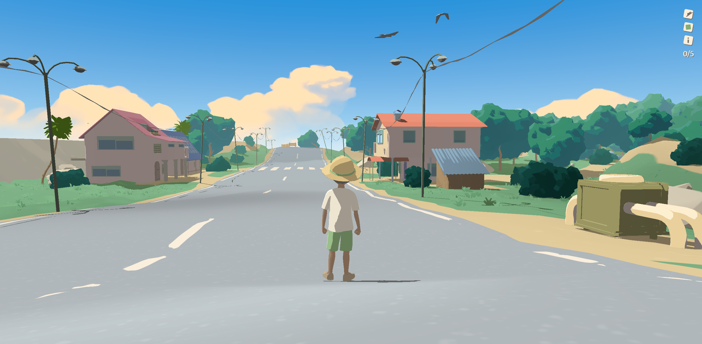

<h1 align="center">RelaxTime</h1>
<p align="center">
 


</p>

An interactive WebGL relax scene: walk a kid around a seaside village with
sea, sky, birds, trees, grass, houses and **5 hidden secrets** (the `0/5`
counter in the corner). Based on **Relax Afternoon**, the WebGL experiment by
[Vicente Lucendo](https://relax-afternoon.vlucendo.com).

This version adds an admin panel with live remote config (Firebase) and its own
WebSocket multiplayer server.

Stack: TypeScript, Vite, three.js `0.148`, three-mesh-bvh, GSAP, Firebase
(config only), Node.js + `ws` (multiplayer).

## Run it

Requires Node.js 18+.

```bash
npm install
npm run dev        # http://localhost:5173  (game + admin + multiplayer)
npm run build      # tsc -b && vite build → dist/
npm run server     # serve dist/ + multiplayer on http://localhost:8787
npm run preview    # Vite preview of the production build
npm run typecheck  # tsc -b --noEmit
```

## Controls

| Action | Keyboard / mouse | Touch | Gamepad |
|---|---|---|---|
| Move | `WASD` / arrows, or hold left mouse toward the cursor | drag (virtual joystick) | left stick |
| Sprint | hold `Shift` | push the joystick to the rim | RB / R1 or L3 |
| Jump | `Space`, or quick right-click | tap | A / ✕ |
| Chat (whole room) | `Enter` to open, `Enter` to send, `Esc` to close | chat button | — |
| Emote | `E` wave · `1` wave · `2` clap · `3` dance · `4` bored · `5` sit cross-legged · `6` fishing · `7` lie on the belly · `8` sunbathe · `9` guitar · `0` kite · `Q` ice cream · `H` high five · `C` walk a dog · `M` walk a cat, or the smiley button menu | smiley button menu | Y / △ (wave) |

Wave and clap stop after 3 s; the others last until you move (pressing the
same emote again also stops it) — except guitar, kite, ice cream and walking a pet,
which keep playing while you walk (upper body from the emote, legs from the run cycle).
Fishing (`6`), guitar (`9`), kite (`0`) and ice cream (`Q`) need their item
from the shop (🔒 in the menu until bought; pressing the key opens the shop).
High five (`H`) turns you toward the nearest player and raises a hand; when two
raised hands are close, both clients show a 👏 burst. Emotes and sprinting are visible to other
players. Wave, clap, dance, sit, fishing, lying prone and sunbathing are generated in
code from the idle pose (`src/scene/emotes.ts`), so no extra animation assets are needed; the
fishing rod, line, bobber and fish are small instanced props that follow each
character's right hand (`src/scene/fishing.ts`); the guitar sits in front of the
belly with its neck in the left hand (`src/scene/guitar.ts`). The dog / cat (`src/scene/pets.ts`)
is a low-poly pet that follows its owner on a leash, legs stepping with its speed.

## NPCs

Client-side characters (`src/scene/npcs.ts`): every client runs the same small
scenes, so all players see them alike without network traffic. Each group is
toggled live in the admin panel (section **NPC**, `config.features.npcs`):

- **seaCouple** — two kids sitting on the beach watching the sea, the boy holding the girl by the waist.
- **kiteFlyers** — two kids strolling on the beach with kites (walk 7 s, stop
  5 s), laughing now and then ("ha ha!").
- **guitarist** — a kid playing guitar and singing (♪ notes) at the far end of
  the road below the spawn.

Optional sounds, picked up automatically when present (louder when close):
`public/assets/audio/npc-laugh.mp3` (laughter, one-shot) and
`public/assets/audio/guitarsong1.mp3` (guitar / song, looped).

NPCs are drawn by the same instanced mesh as players (outfits, emotes, props)
but use ids prefixed `npc:`; they are excluded from `forEachCharacter`
(name tags, high five) and survive network reconnects.

## Outfits (character picker)

The person button opens the picker: **Nam / Nữ** presets plus one row per
equipment slot — Mũ (hat), Kiểu tóc (hair), Áo (top), Quần / váy (bottom),
Giày dép (shoes), Kính (glasses), Dây chuyền (necklace). Choices apply live and
are visible to other players. Items sold in the shop show 🔒 until bought
(clicking one opens the shop on it). Signed-in players' outfits are kept by the
relay per account (any device); guests' only on that device (`localStorage`).

How it works (`src/scene/appearance.ts`):

- Every vertex of the kid mesh belongs to a **part** (hat, t-shirt, shorts,
  sandals… split from the original mesh by color; skirt, hairstyles, hair cap,
  bare feet, glasses, cap, recolored shirts / jeans / shoes, necklaces
  generated in code and skinned to the same bones).
- Shop items use fixed colors from a small palette (`COLOR` in
  `appearance.ts` = `charPalette()` in `src/scene/glsl/fragment.glsl`,
  `colorInfo.y = 3`).
- An **item** is a list of parts (`ITEM_PARTS`); slots and items come from the
  shared catalog `shared/shop-catalog.json`. Each character gets a
  visibility bitmask (`instanceParts`) and the shader hides everything else
  (up to 24 parts, 21 used), so all animations and emotes work with every outfit.
- The outfit (one item index per slot) is sent as its own message when joining
  and when it changes (`[2][n][items]`). The server replaces items the account
  does not own with the slot default, relays `[4][id][n][items]` (also to
  players who join later) and sends the corrected outfit back to the sender
  when it differs.

To add a shop item: add its geometry as a new part (a `.glb` skinned to the
same skeleton, or code) with a `PART` id, **append** the item to its slot in
`shared/shop-catalog.json` (the order is the wire format) and list its parts in
`ITEM_PARTS`. The admin panel picks it up automatically (default price 1).

## Chat & display names

- **Chat:** every line goes to the whole room (the log at the bottom left) and
  pops up as a speech bubble over the speaker (`src/components/nametags.ts`). The relay cleans each line
  (invalid UTF-8, control/bidi characters, max 160 characters) and allows a
  burst of 5 lines, then one every 2 s.
- **Names:** players show as `Người dùng ẩn danh <id>` until they have an
  account name. The name is picked when signing up (*Đăng ký* in the sign-in
  modal; email + password). The account card at the top of the character panel
  shows the name and email, renames (relay-verified) and signs out; a new device
  reads the name back from the Firestore profile (`users/{uid}.name`). The
  sign-in form has "Quên mật khẩu?" (Firebase password reset email). Without a
  Firebase config the game says accounts are off and hides the sign-up buttons. The relay verifies the
  Firebase ID token (`server/firebase-auth.mjs`, no extra dependency) before
  showing the name to anyone. The name is remembered per account on that
  device and re-claimed on every reconnect. The email is never shown. Names
  are shown in the chat log only, not over the characters.
- **Setup:** Firebase Console → Authentication → Sign-in method → enable
  **Email/Password**, and add your site's domain under *Authorized domains*. The relay
  reads the project id from `FIREBASE_PROJECT_ID` (or `VITE_FIREBASE_PROJECT_ID`;
  `npm run dev` takes it from `.env`). Without it, name changes are refused and
  everyone stays a guest; chat still works.
- Code: `src/components/chat.ts`, `src/components/nametags.ts` (bubbles),
  `src/components/authModal.ts` (sign-in / sign-up modal),
  `src/social/` (email/password accounts, names), `server/realm.mjs` (messages 5–7).

## Daily rewards (flowers)

The flower button in the corner menu opens *Quà mỗi ngày*. Flowers (🌸) are the
currency of the shop (below). Every player gets, per calendar day in Vietnam time:

- **Check-in** once a day: 5 flowers, Saturday and Sunday 10.
- **Online milestones**, one after the other: 10 min → 5, then 30 more min
  → 10, then 1 more hour → 15. A milestone's clock starts when the previous
  one is claimed and stops once reached, until claimed. Time only counts
  while a game tab of the account is visible (the client reports
  `visibilitychange`); several tabs count once.

The relay decides and stores everything (`server/wallets.mjs`), so players
cannot edit their balance: `wallets.json` in `DATA_DIR` (default
`server/data/`, git-ignored).
`REWARDS_TZ` changes the calendar time zone.

**Guests** (not signed in) play the same way with a wallet tied to their browser
tab: a random key in `sessionStorage` (`[8] GUEST` message), kept in the relay's
memory only. Reloading keeps it, closing the tab loses it: the rewards and shop
panels warn about it, and the first flower or item opens a *Lưu dữ liệu của bạn*
modal (`src/components/guestModal.ts`, once per tab; browsers do not allow a
custom dialog when the tab closes, so there is no close prompt). Signing up moves the guest wallet into the new
account (`wallets.adopt`, WALLET `result.sync = "adopted"`); signing in to an
account that already has progress keeps the two apart (`"skipped"`).

## Shop (flowers)

Two buttons in the corner menu:

- **Cửa hàng** (bag button) — items by shelf: *Trang phục* (Áo xanh biển, Áo hồng, Quần
  jean), *Giày dép* (Giày thể thao, Giày vải đỏ), *Phụ kiện* (Mũ rơm, Mũ lưỡi
  trai, Kính râm, Kính tròn, Dây chuyền vỏ sò, Vòng hoa) and *Đồ dã ngoại*
  (Cần câu, Đàn guitar, Diều, Kem). **Mua** then a second click confirms;
  items you cannot afford show how many flowers are missing. Bought clothes
  are put on right away.
- **Tủ đồ** — tab of the character panel (colour-square button, next to the
  *Nhân vật* tab with name, outfit rows and random colour): what the account
  owns, *Mặc / Đang mặc* (click to take off) for clothes, *Dùng* for picnic
  items (same as their emote key). Shop links to an item already owned
  (`shop_open`) open it here instead.

The basic items (t-shirt, shorts, skirt, sandals, bare feet, no hat / glasses
/ necklace, every hairstyle) stay free for everyone, guests included.

**Prices** are set in the admin panel, section **Cửa hàng** (`config/scene` →
`shop.items.<id>` = `{ price, enabled }`, default 1 flower; 0 = free to
claim; *Đang bán* off hides an item, owners keep it). The game shows them live;
the relay reads the same document through the Firestore REST API (no
credentials, the config is public), caches it 30 s and checks again when a
buyer saw another price (answer *giá vừa đổi*).

**The relay decides everything** (`server/shop.mjs`, `server/realm.mjs`):

- purchase `[7][{"buy": id, "price": n}]` → checks sign-in, item for sale,
  not owned, price, balance; then spends the flowers and records the item in
  the wallet (`owned`, `spent`, last 50 `purchases`) and answers every session
  of the account with a WALLET carrying `result.shop`;
- outfits: items not owned are shown as the slot default (see Outfits); the
  account's outfit is saved in its wallet and put back on at every sign-in,
  and signing out takes bought items off;
- emotes: the states of unowned picnic items are relayed as standing.

Code: `shared/shop-catalog.json` (catalog, shared), `src/shop/` (typed
catalog, ownership + prices on the client), `src/components/shop.ts` (panel),
`src/admin/fields.ts` (price section).

## Admin panel & remote config (Firebase)

Scene parameters (UI texts, secrets' text/position/rotation/scale/trigger
distance, scene tint/brightness/color grading, grass colors, volume, player
spawn and forces, module and multiplayer toggles, multiplayer server URL) live in one Firestore document, `config/scene`, edited
from `/admin.html`. The game reads it at boot (4 s timeout, then built-in
defaults) and keeps listening, so most edits apply live to open sessions;
fields marked *tải lại* in the panel only apply after a page reload.

Without a `.env`, Firebase is never loaded and the game runs on the defaults
in `src/config/schema.ts`.

Setup:

1. Create a Firebase project, enable **Firestore** and **Authentication →
   Email/Password**, and register a **Web app**.
2. `cp .env.example .env` and fill in the `VITE_FIREBASE_*` values, then
   restart `npm run dev`.
3. Authentication → Users → add the admin account (email + password).
4. Firestore → create collection `admins` with a document whose id is that
   user's **UID** (any content). The admin page also shows the UID after
   signing in.
5. Publish the rules in `firestore.rules` (Firestore → Rules, or
   `firebase deploy --only firestore:rules`): anyone can read the config,
   only uids in `admins` can write it.
6. Open `http://localhost:5173/admin.html`, sign in, edit, **Lưu**.

Code: `src/config/` (schema + defaults, Firebase bootstrap, live store),
`src/admin/` (panel), `admin.html`.

### User management

The panel's **Người dùng** menu has two pages:

- **Tài khoản** – player profiles from Firestore `users/{uid}`. The game
  creates the profile on a player's first sign-in and updates the email, name
  and last sign-in time after that (`src/social/auth.ts`), so accounts that
  existed before this feature appear after their next sign-in. Admins can
  search and filter (online / banned / admin), **ban / unban** an account
  (with an optional private reason), and **grant / revoke admin** (`admins/{uid}`;
  nobody can revoke their own rights).
- **Đang online** – live connections from the relay, by room (name, account,
  time online, position), with **Kick** and **Khoá**. It refreshes every 5 s.

A ban is enforced in three places: the game signs a banned account out and
refuses to sign it in, the relay refuses its display name (it reads
`users/{uid}.banned` through the Firestore REST API with the player's own
ID token), and the admin page tells the relay to disconnect it at once.
Kicked or banned clients get WebSocket close code 4001 / 4003 and do not
reconnect automatically.

The online page talks to the relay's admin API (`server/admin-api.mjs`,
`/admin/api/players|kick|ban`). Requests carry the admin's Firebase ID token;
the relay verifies it and checks `admins/{uid}` with that same token, so no
service account is needed, but `FIREBASE_PROJECT_ID` (or
`VITE_FIREBASE_PROJECT_ID`) must be set on the relay. Deleting or disabling
Firebase Auth accounts themselves still happens in the Firebase Console.

After updating, publish the new `firestore.rules` (they add the `users`
collection and let admins manage `admins`).

## Feedback (Góp ý)

The letter button (✉) in the corner menu opens *Góp ý*: one textarea
(5–1000 characters, Ctrl/⌘ + Enter sends). After sending, the panel shows a
thank-you letter card instead of the form until the next day.

- **Anti-spam:** one feedback per calendar day (Vietnam time, `REWARDS_TZ`)
  per account when signed in, per IP for guests; at most 5 per IP and 1000 for
  everyone per day. The relay enforces it (`server/feedback.mjs`,
  `POST /api/feedback`, answers 429 `already`); the browser also remembers
  the day so the thank-you card shows right away. IPs are only kept hashed
  (salted per day) for the counters. Behind a proxy the IP comes from
  `X-Forwarded-For`, like the WebSocket limits.
- **Storage:** `feedback.json` in `DATA_DIR` (text, time, uid, browser,
  status, admin note); the oldest go past 5000.
- **Admin:** *Người dùng → Góp ý* lists them newest first with the sender's
  name / email (Firestore profile), filters (Mới / Đã đọc / Đã xử lý / Tất cả),
  search, a private note, copy and delete. It uses the relay's admin API
  (`/admin/api/feedback`, `/feedback/update`, `/feedback/delete`), so the
  same `FIREBASE_PROJECT_ID` setup as the online page applies.

Code: `src/components/feedback.ts` (panel), `server/feedback.mjs`,
`src/admin/feedback.ts` (admin page).

## Multiplayer server (WebSocket)

Remote players go through our own relay, `server/realm.mjs` (Node.js + `ws`),
not a third-party network. Clients send a 26-byte binary state frame when they
move (plus a 2 s heartbeat); the server keeps the latest frame per player and
broadcasts the changed ones 20×/s to everyone in the same room.

- **Development:** `npm run dev` already runs the relay on the same port
  (`ws://localhost:5173/mp`, counts at `/health`). Nothing else to start.
- **Production:** `npm run build && npm run server` serves the site, the admin
  page, `/mp` and `/health` from one process on port 8787. Or with Docker:
  `docker build -t dongque . && docker run -p 8787:8787 dongque`.
  Behind HTTPS, proxy WebSocket upgrades on `/mp` (the client then uses
  `wss://`).
- **Server URL:** by default the game connects to `/mp` on the page's own
  host. Override with `VITE_MULTIPLAYER_URL` at build time or the
  *Địa chỉ server multiplayer* field in the admin panel.
- **Server settings (env):** `PORT`, `HOST`, `STATIC_DIR`,
  `MAX_PLAYERS_PER_ROOM` (127), `TICK_MS` (50), `VIEW_DISTANCE` (0 = relay
  everyone; otherwise only nearby players), `ALLOWED_ORIGINS`,
  `MAX_CONNECTIONS` (1000), `MAX_PER_IP` (12, from `X-Forwarded-For` behind a
  proxy), `MAX_ROOMS` (20),
  `FIREBASE_PROJECT_ID` (account-verified names, see above; with Docker pass
  `-e FIREBASE_PROJECT_ID=...`).
- **HTTP:** brotli/gzip for JS, CSS, HTML, JSON and wasm; hashed build files
  cached for a year (`immutable`), other assets a day, HTML revalidated;
  security headers (CSP, `nosniff`, `X-Frame-Options: DENY`, HSTS,
  `Referrer-Policy`). The CSP allows `unsafe-eval` only because the Basis
  texture transcoder needs `new Function` in its worker.
- **Moderation:** display names are unique among online players (accents and
  case ignored) and names like Admin / Quản trị / Hệ thống are refused
  (NOTICE 6). A kick refuses that IP for 10 min, a ban for 6 h (so the player
  cannot come back as a guest); unbanning lifts it. Online rewards only count
  while the player did something (moved, changed pose, chatted) in the last
  10 min. On Render, `ALLOWED_ORIGINS` defaults to `RENDER_EXTERNAL_URL`.
- **Protections:** frame validation (size, version, finite coordinates),
  40 frames/s per client (extra dropped, flooding disconnects), 4 KB max
  message, chat rate limit, ping every 15 s to drop dead connections.

## Architecture

**Boot flow**, `index.html` → `src/main.ts`: UA sniffing, WebGL2 capability
check (fallback message if missing), engine init (renderer + composer + input),
`MainController` mounts a fullscreen-triangle material, `EnvironmentScene`
loads its 24 subsystems in parallel, then the loader hides and the intro plays.

**Engine core** (`src/engine/`)
- `globals.ts`, the engine singleton: `WebGLRenderer` (no AA/stencil/depth,
  sRGB output) hidden inside a **closed shadow root** (the DOM shows no canvas),
  EffectComposer + SMAA + gamma pass, a shared `UniformsGroup` global clock
  (`resolution` / `time` / `dtRatio`) consumed by every custom shader, and an
  **adaptive DPR** controller that steps pixel ratio 0.7–1.0 to hold 30–60 fps.
- `scene.ts`, base scene with `beforeRenderCbs` (per-frame hooks) and a
  **warm-up upload pass**: renders everything into a dummy target twice so all
  shaders/textures are compiled and resident before the first real frame.
- `events.ts` / `input.ts` / `controls.ts`, the app's event bus (`webgl_*`
  events) wired to touch (virtual joystick, tap-to-jump), mouse, wheel, keyboard
  and gamepad input.
- `loaders/`, the custom `.bin` geometry format: 4-byte JSON header
  (attributes/layout) + interleaved binary payload, decoded via the bundled
  Draco/Basis wasm; plus `instancedPatches` (splits instances into per-patch
  meshes for frustum culling + LOD) and texture-animation/skin loaders.
- `physics.ts`, three-mesh-bvh accelerated sphere-vs-triangle collision with
  floor detection, position forces and damping (the kid walks the terrain).
- `sunlight.ts`, `FollowSunLight`: a directional sun that follows the camera
  and bakes a **cascaded shadow map** per LOD level.
- `audio.ts`, `AudioController`: 5 preloaded loops, positional listener,
  per-frame player-position updates, forest↔beach crossfade by world X.
- `multiplayer/`, `SocketConnection` (WebSocket client for `server/realm.mjs`)
  and the 26-byte character state codec; remote players are interpolated in
  `characters.ts`.

**Scene modules** (`src/scene/`), `environmentScene.ts` composes 24 subsystems
(characters, sky, terrain, sea, birds, trees, bushes, lightposts, palmtrees,
houses, warehouses, machines, rocks, parasols, castles, grass, blockers, ufo,
alien, sign, cats, sloth, gossip), each a `SceneModule` exposing `ready`. The
sea is a 256px planar reflection; the birds are 25 GPU-computed particles
following baked curve paths with vertex-texture-animated flapping; grass bends
away from the character via shared `charPos`/`charSpeed` uniforms; the
ufo/alien/cats/sloth/gossip each hide one of the 5 secrets.


## Layout

```
src/
├── core/            # client (UA), events, deferred, math, ticker/clock
├── engine/          # renderer/composer/adaptive-DPR, scene, cameras, input,
│                    # physics (BVH), characters, particles (GPU), sunlight (CSM),
│                    # audio, loaders (bin/geometries/instancing/textures),
│                    # multiplayer (WebSocket client + state codec)
├── scene/           # mainController, environmentScene, materials, shaders-post,
│                    # sky, sea, terrain, birds, vegetation, structures, setpieces,
│                    # characters + glsl/ (verbatim shader files)
├── components/      # ui.ts, plain-DOM UI (loader, nav, easter counter, modals)
├── config/          # remote config: schema + defaults, Firebase bootstrap, live store
├── shop/            # shop catalog (typed) + what the local player owns, prices
└── admin/           # admin panel (admin.html)

shared/              # shop-catalog.json, read by the game and the relay
server/              # multiplayer relay (realm.mjs, wallets.mjs, shop.mjs) + standalone static server (index.mjs)
public/assets/       # geometries (.bin), textures, audio, fonts, Draco/Basis decoders
firestore.rules      # Firestore security rules (config read-only for players)
```

## Credits & disclaimer

- Original experience: **Relax Afternoon** by **Vicente Lucendo**,
  https://relax-afternoon.vlucendo.com
- All 3D assets, textures, audio, fonts and the original code belong to their
  respective authors; this project is not affiliated with or endorsed by the
  original author.
